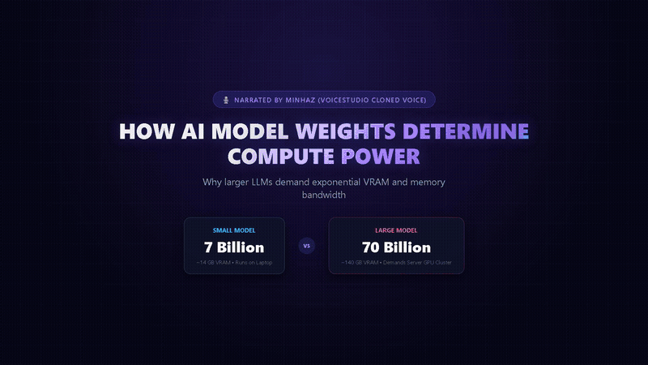
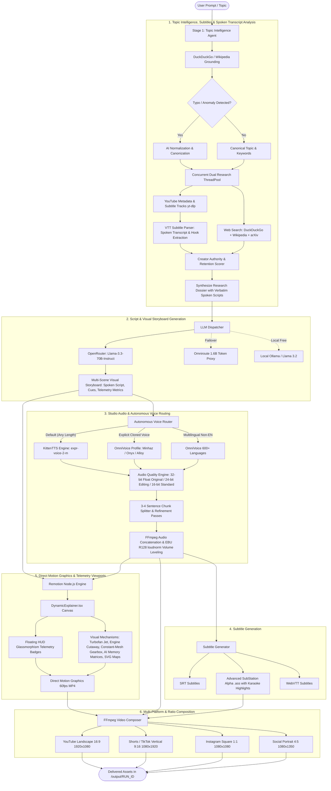

# 🌌 OmniStudio

> **Autonomous End-to-End AI Video Generation, Mechanical Simulation & Technical Content Engine**

[](https://remotion.dev)
[](https://github.com/remotion-dev/skills)
[](https://python.org)
[](https://nodejs.org)
[](https://github.com/omniroute/openstudio)
[](https://openrouter.ai)
[](https://ffmpeg.org)
[](LICENSE)

---

## 📖 Table of Contents

- [Product Demo](#-product-demo)
- [Overview](#-overview)
- [System Architecture](#-system-architecture)
- [Key Features](#-key-features)
  - [1. Topic Intelligence & Self-Healing Research](#1-topic-intelligence--self-healing-research)
  - [2. Anti-Misconception Script Synthesis](#2-anti-misconception-script-synthesis)
  - [3. Autonomous Voice Routing & KittenTTS](#3-autonomous-voice-routing--kittentts)
  - [4. React/Remotion Visual Mechanisms & Simulation](#4-reactremotion-visual-mechanisms--simulation)
  - [5. FFmpeg Multi-Format Video Composition](#5-ffmpeg-multi-format-video-composition)
- [Visual Mechanical Engine in Action](#-visual-mechanical-engine-in-action)
  - [Motorcycle Constant Mesh Gearbox](#motorcycle-constant-mesh-gearbox)
  - [AI Neural Weights & GPU Silicon Bandwidth](#ai-neural-weights--gpu-silicon-bandwidth)
- [Installation & Setup](#-installation--setup)
- [Usage Guide](#-usage-guide)
  - [Single-Command Execution](#single-command-execution)
  - [CLI Reference](#cli-reference)
  - [Selecting Cloned Voices](#selecting-cloned-voices)
- [Project Structure](#-project-structure)
- [Configuration Reference](#-configuration-reference)
- [Roadmap & Contributing](#-roadmap--contributing)
- [License](#-license)

---

## 🎬 Product Demo

<p align="center">
  
</p>

<p align="center">
  ▶️ <b>Watch the Full 1080p Video with Narration</b>: <a href="assets/demo/omnistudio_demo.mp4"><code>assets/demo/omnistudio_demo.mp4</code></a> (1m 18s)<br>
  <i>Features: KittenTTS voice synthesis, real-time parameter counter matrices, memory equation formulas, and high-speed GPU memory bandwidth streaming.</i>
</p>

---

## 🚀 Overview

**OmniStudio** is a fully autonomous, production-grade video content generation engine designed to transform any raw technical or mechanical topic into an authentic, publication-ready video in a single terminal command.

Unlike conventional automation tools that assemble static text bullet slides over stock footage, OmniStudio generates **domain-aware interactive engineering animations, mathematical kinematic cutaways, and hardware simulations**:

* **Got a mechanical topic?** (e.g., *"How a bike's gear box works"*): It renders a 4-stroke engine cutaway with reciprocating piston and spinning counterweighted crankshaft, executes a dynamic camera dive transition inside the engine casing, isolates the constant-mesh transmission cavity, and runs real-time meshing involute gear pairs with sliding dog clutches and shifting torque flow lines.
* **Got an AI/Computing topic?** (e.g., *"How AI model weights determine compute power"*): It visualizes multi-layer neural synaptic networks, dives into floating-point weight matrices (FP16 vs INT4 quantization), and animates GPU high-bandwidth memory (HBM3) streaming bus saturation.

Every video is voiced with natural, ultra-fast **KittenTTS** (or personalized cloned voices like **Minhaz Voice**), synchronized with word-by-word burned-in subtitles, and automatically delivered in **16:9 YouTube** (1080p) and **9:16 Shorts / TikTok** (1080×1920).

---

## 🏛️ System Architecture

The following diagram illustrates how raw user input flows through the 6 autonomous stages of OmniStudio:



---

## ✨ Key Features

### 1. Topic Intelligence & Competitor Transcript Analysis
* **YouTube Spoken Transcript Extraction**: Uses `yt-dlp` subtitle tracks to extract real spoken English transcripts and subtitles from high-ranking competitor videos without downloading any heavy media files.
* **Competitor Hook & Retention Deconstruction**: Parses VTT cues into clean continuous prose and extracts verbatim opening hooks from spoken audio, feeding them to the scriptwriter to engineer a superior hook in the first 3 seconds.
* **Automatic Typo & Error Identification**: Catches transposed, misspelled, or fabricated AI models and engineering terms (e.g., inputting `Spark-X2.6-71.7B` is automatically identified as the real `Spark-X2.6-1.7B` 1.71B-parameter dense model).
* **Live Search-Augmented Grounding**: Probes DuckDuckGo and Wikipedia before making decisions to anchor LLM responses in real-world facts.
* **Cascading Multi-Tier Research**: If YouTube results are sparse (<2 videos), cascades seamlessly to live internet documentation and technical specs.

### 2. Anti-Misconception Script Synthesis & Multi-Scene Storyboards
* **Multi-Scene Visual Storyboarding**: Mandates 3 to 5 progressive visual scenes with synchronized `visual_cue`, `graphic_type` (e.g., `turbofan`, `mechanism`, `compute`, `map`), and live telemetry data (`key_metric`). Banish generic single-section bullet lists forever.
* **Zero-Hallucination Prompt Engineering**: Designed specifically to explain real engineering and computer science principles without hand-wavy buzzwords.
* **Exact Mathematical & Physical Grounding**:
  * **AI Computing**: Enforces VRAM equations, memory bandwidth bounds, and quantization trade-offs (FP16 vs INT8 vs INT4).
  * **Jet Propulsion**: Explains cold air bypass ratios ($85-90\%$ thrust from the front fan), $40:1$ core compression ratios, turbine expansion, and convergent supersonic exhaust nozzles ($F = \dot{m} \cdot \Delta v$).
* **OpenRouter + Omniroute Failover**: Uses **OpenRouter** (`meta-llama/llama-3.3-70b-instruct`) for rapid, high-accuracy script generation, with automatic failover to the local **Omniroute** proxy (1.6 Billion tokens) or local **Ollama**.

### 3. Studio Voice Routing & 3 Audio Quality Categories
* **Universal KittenTTS & OmniVoice**: Synthesizes clean, high-speed, engaging explainer narration across scripts of any length with zero cold-start delay, or switches to custom cloned voice profiles (e.g. `--voice-name Minhaz`).
* **3 Studio Audio Quality Categories**:
  * **`original` (Default)**: **32-bit float** (`pcm_f32le` / 320 kbps MP3) preserving pristine dynamic range without digital clipping.
  * **`editing` / `for editing`**: **24-bit PCM** (`pcm_s24le` / 320 kbps MP3) tailored for studio DAW mixing, DaVinci Resolve, and Premiere Pro.
  * **`standard`**: **16-bit PCM** (`pcm_s16le` / 192 kbps MP3) for compact, lightweight sharing.
* **Voice Refinement Passes**: Configurable iteration passes (default: `19`) balancing generation speed and acoustic fidelity.
* **Even Out Volume (EBU R128 `loudnorm`)**: Seamlessly normalizes integrated loudness ($I = -16$ LUFS, $TP = -1.5$ dBFS) across chunked sentence segments to prevent jarring audio jumps.

### 4. React/Remotion Visual Mechanisms & Telemetry HUD
* **Direct Motion Graphics Engine**: High-performance React motion graphics built directly on `DynamicExplainer.tsx` and `VisualMechanismViewport.tsx`.
* **Glassmorphism Telemetry HUD**: Renders real-time floating cyan HUD badges displaying active parameters (e.g., `Bypass Ratio: 10:1`, `Core Temp: 1,700 °C`, `Compression: 40:1`).
* **Turbofan Jet Mechanism (`TurbofanJetMechanism.tsx`)**: High-bypass front fan with rotating blades, multi-stage counter-rotating axial compressor spools, pulsing annular combustor flames, and supersonic exhaust nozzle with Mach shock diamonds.
* **Motorcycle Constant Mesh Gearbox (`SequentialGearboxMechanism.tsx`)**: 6-speed constant mesh transmission with sliding dog clutch collars and neon torque flow lines.
* **Engine Slider-Crank Cutaway (`EngineCrossSection.tsx`)**: Reciprocating piston with spark plug ignition and counterweighted crankshaft.
* **Silicon Compute Visualizer**: Synaptic node networks, quantized weight matrix registers, and GPU HBM3 memory bus streaming.
* **Vector Geographic Viewport (`MapViewport.tsx`)**: SVG world projection with animated bezier transit arcs and glowing radar ping coordinates.

### 5. Multi-Platform & Ratio Composition
* **Multi-Aspect Ratio Support**: Generates pixel-perfect videos in **16:9 Landscape** ($1920\times 1080$), **9:16 Vertical** ($1080\times 1920$), **1:1 Square** ($1080\times 1080$), and **4:5 Portrait** ($1080\times 1350$).
* **Advisory Duration Budgeting**: Pass `--duration <seconds>` to automatically calibrate narration word counts ($2.3-2.6$ words/sec) and section duration hints to fit your target video length.
* **Burned-In Subtitles**: Word-by-word karaoke-highlighted subtitles (`.ass`) rendered with safe-zone margins for each target social platform.

---

## ⚙️ Visual Mechanical Engine in Action

### High-Bypass Turbofan Jet Engine & Supersonic Nozzle
For aerospace and propulsion topics, OmniStudio choreographs a 4-stage physics cutaway with live telemetry:

```
[ Stage 1: Cold Air Bypass Stream ]
   Titanium front fan accelerates to 3,000 RPM.
   85-90% of total thrust produced by unburned cold air flowing around outer duct.
   HUD Telemetry: Bypass Ratio: 10:1 | Airflow: 1,200 kg/s.
           │
           ▼
[ Stage 2: Multi-Stage Axial Compression ]
   Low-pressure and high-pressure compressor spools spin in counter-phase.
   Air squeezed from 1 atm to over 40 atm, heating to 600°C.
   HUD Telemetry: Pressure Ratio: 40:1 | Core Compression Active.
           │
           ▼
[ Stage 3: Annular Combustor & Turbine Expansion ]
   Fuel nozzles inject atomized kerosene into compressed airflow.
   Combustion reaches 1,700°C, expanding through single-crystal turbine blades.
   HUD Telemetry: Core Temp: 1,700°C | Turbine RPM: 12,500.
           │
           ▼
[ Stage 4: Supersonic Convergent Nozzle ]
   Convergent exhaust nozzle accelerates hot core gases to supersonic velocity.
   Mach shock diamond pattern forms in high-velocity exhaust plume.
   HUD Telemetry: Net Thrust: 450 kN | Newton's 3rd Law F = m_dot * Δv.
```

### Motorcycle Constant Mesh Gearbox
When tasked with explaining a motorcycle transmission, OmniStudio generates a specialized 4-stage visual narrative:

```
[ Stage 1: Engine Cutaway ]
   Piston reciprocates in cylinder bore (slider-crank kinematics).
   Spark plug flashes at TDC (combustion cycle).
   Crankshaft counterweights revolve smoothly.
           │
           ▼
[ Stage 2: Casing Penetration ]
   Dynamic camera zoom (1.0x -> 2.3x) dives into lower crankcase.
   Laser scan line highlights the shared oil-bath transmission cavity.
           │
           ▼
[ Stage 3: 6-Speed Constant Mesh Mechanism ]
   Mainshaft (input from clutch) & Countershaft (output to drive sprocket).
   All 6 gear pairs continuously spin in contact.
   Sliding dog clutch collar slides laterally along splines into gear pockets.
   Neon torque flow line visualizes power delivery through engaged ratio.
           │
           ▼
[ Stage 4: Gear Ratios & Shifting Telemetry ]
   1st (2.85:1, +185% torque) -> 2nd (1.88:1) -> 3rd (1.40:1) -> 
   4th (1.14:1) -> 5th (0.96:1) -> 6th (0.81:1 overdrive).
   Interactive dashboard displays Engine RPM vs Wheel RPM.
```

### AI Neural Weights & GPU Silicon Bandwidth
For compute and machine learning topics, OmniStudio renders hardware-accurate diagrams:
* **Synaptic Node Network**: Multi-layer perceptron with pulsing forward-pass activations.
* **Floating-Point Matrix Register**: Dynamic bit-representation comparing FP16 (2 bytes), INT8 (1 byte), and INT4 (0.5 bytes).
* **GPU Memory Bus**: High-bandwidth memory (HBM3) dies transferring data packets at 3,350 GB/s to streaming multiprocessors (SMs) and Tensor Cores.

---

## 📦 Installation & Setup

### Quick Setup Wizard (Recommended)
OmniStudio includes an interactive Setup Wizard that inspects your system, installs Python and Node.js dependencies, verifies Chrome Headless Shell, and configures your `.env` settings:

```bash
git clone https://github.com/MinhaulMahmud/OmniStudio.git
cd OmniStudio

# 1. Run the interactive setup wizard
python setup.py

# 2. Verify all diagnostics pass
python setup.py --check
```

### Manual Setup (Alternative)

<details>
<summary>Click to view manual step-by-step instructions</summary>

#### 1. Python Environment Setup
```bash
cd ContentAutomation
python -m venv venv

# Windows
.\venv\Scripts\activate
# Linux / macOS
source venv/bin/activate

pip install -r requirements.txt
```

#### 2. Remotion Graphics Engine Setup
```bash
cd remotion
npm install
npx remotion browser ensure
cd ..
```

#### 3. Configure Environment Variables
Copy `.env.example` to `.env` in `ContentAutomation/`:
```bash
cp .env.example .env
```
</details>

### Configuration Reference (`ContentAutomation/.env`)
```env
# Primary LLM API (OpenRouter)
OPENROUTER_API_KEY=sk-or-v1-your-key-here
OPENROUTER_MODEL=meta-llama/llama-3.3-70b-instruct

# Voice Configuration
VOICESTUDIO_URL=http://localhost:3900
DEFAULT_VOICE=kitten
TTS_PROVIDER=kitten
```

---

## 🎨 Direct Motion Graphics & Visual Choreography Pipeline

OmniStudio renders visuals through a **direct, frame-synchronized React motion graphics engine** (`DynamicExplainer.tsx` + `VisualMechanismViewport.tsx`), eliminating generic presentation slide cards in favor of authentic mechanical simulations, vector graphics, and live telemetry:

```
┌────────────────────────────────────────────────────────────────────────┐
│             Direct Motion Graphics & Telemetry Architecture            │
├────────────────────────────────┬───────────────────────────────────────┤
│ 1. Synchronized Storyboard     │ Llama 3.3 70B plans multi-stage scenes│
│    (script_generator.py)       │ with explicit visual cues, animation  │
│                                │ categories, and key metric telemetry. │
├────────────────────────────────┼───────────────────────────────────────┤
│ 2. DynamicExplainer Canvas     │ Universal React/Remotion canvas with   │
│    (DynamicExplainer.tsx)      │ multi-layer animated particle field,   │
│                                │ kinetic typography, and HUD overlays. │
├────────────────────────────────┼───────────────────────────────────────┤
│ 3. Domain Mechanism Viewports  │ Dedicated physics-driven simulators:  │
│    (components/)               │ TurbofanJetMechanism, EngineCutaway,  │
│                                │ SequentialGearbox, SiliconHBM3, Maps. │
├────────────────────────────────┼───────────────────────────────────────┤
│ 4. Floating Telemetry HUD      │ Glassmorphism cyan HUD telemetry      │
│    (keyMetric badging)         │ badges displaying real-time metrics,  │
│                                │ ratios, pressures, and formulas.      │
└────────────────────────────────┴───────────────────────────────────────┘
```

### Visual Engine Mechanisms
* **Turbofan Jet & Supersonic Exhaust (`TurbofanJetMechanism.tsx`)**: High-bypass front fan with rotating blades, multi-stage counter-rotating axial compressor spools, pulsing annular combustor flames, and supersonic exhaust nozzle with Mach shock diamonds.
* **Motorcycle Constant Mesh Gearbox (`SequentialGearboxMechanism.tsx`)**: 6-speed constant mesh transmission with sliding dog clutch collars and neon torque flow lines.
* **4-Stroke Engine Slider-Crank Cutaway (`EngineCrossSection.tsx`)**: Reciprocating piston with spark plug ignition and counterweighted crankshaft.
* **Silicon Compute & Neural Matrix Visualizer**: Synaptic node networks, quantized weight matrix registers, and GPU HBM3 memory bus streaming.
* **Geographic Vector Projections (`MapViewport.tsx`)**: Natural TopoJSON/SVG world projection with animated bezier transit arcs and glowing radar ping coordinates.

---

## 💻 Usage Guide

### Single-Command Execution
Generate an end-to-end video (competitor transcript research, script synthesis, studio voiceover, Remotion motion graphics, multi-format composition) in one command:

```bash
# Aerospace / Turbofan Explainer (Vertical Shorts format)
python pipeline.py --topic "Jet Propulsion Basics" --ratio 9:16

# Mechanical Engineering (YouTube 16:9 format with custom duration)
python pipeline.py --topic "how bike gearbox works" --ratio 16:9 --duration 60

# AI Technology with Cloned Voice and 32-bit Float Original Quality
python pipeline.py --topic "AI model weights" --voice-name Minhaz --audio-quality original
```

### CLI Reference

```text
usage: pipeline.py [-h] [--topic TOPIC] [--topics TOPICS]
                   [--platform {youtube,shorts,tiktok,instagram_reels}]
                   [--ratio {16:9,9:16,1:1,4:5}]
                   [--duration DURATION]
                   [--voice-model {kittentts,omnivoice}]
                   [--voice-name VOICE_NAME] [--voice-id VOICE_ID]
                   [--audio-quality {original,editing,standard}]
                   [--voice-refinement VOICE_REFINEMENT]
                   [--even-out-volume] [--no-even-out-volume]
                   [--language LANGUAGE] [--list-voices]
                   [--no-research] [--no-video] [--remotion]
                   [--no-remotion] [--output-dir OUTPUT_DIR]

Options:
  --topic TOPIC                    Single topic to generate content for
  --topics TOPICS                  Comma-separated list of topics
  --platform PLATFORM              Platform preset: youtube, shorts, tiktok, instagram_reels
  --ratio RATIO                    Target aspect ratio: 16:9, 9:16, 1:1, 4:5
  --duration SECONDS               Advisory video duration in seconds (calibrates narration pacing)
  --voice-model MODEL              Voice engine: kittentts (fast explainer) or omnivoice (clones)
  --voice-name, --voice NAME       Voice name (e.g. expr-voice-2-m, Minhaz, onyx, alloy)
  --voice-id ID                    Explicit voice ID from VoiceStudio
  --audio-quality QUALITY          Studio quality: original (32-bit float), editing (24-bit PCM), standard (16-bit PCM)
  --voice-refinement PASSES        Refinement iterations (default: 19)
  --even-out-volume                Enable EBU R128 loudness normalization across chunks (default: True)
  --no-even-out-volume             Disable loudness normalization
  --language LANG                  Narration language (e.g. en, es, fr, bn, hi, auto)
  --list-voices                    List all available voices in VoiceStudio and exit
  --no-research                    Skip yt-dlp competitor & web research step
  --no-video                       Only generate script and audio, skip video rendering
  --remotion                       Render React Remotion motion graphics (default: True)
  --no-remotion                    Disable Remotion; compose static background video with FFmpeg
```

### Selecting Cloned Voices & Studio Audio Quality
By default, OmniStudio uses **KittenTTS** (`expr-voice-2-m`) with **Original 32-bit float audio quality** and **19 refinement passes** for crystal-clear, studio-grade narration.

To inspect available voices and configure audio parameters:
```bash
# 1. List all available voices
python pipeline.py --list-voices

# 2. Run with your cloned voice and studio editing quality
python pipeline.py --topic "Turbofan Engines" \
  --voice-name Minhaz \
  --audio-quality editing \
  --voice-refinement 25 \
  --ratio 9:16
```

---

## 📁 Project Structure

```text
OmniStudio/
├── README.md                          # Project Documentation & Architecture
├── .gitignore                         # Git exclusion rules
├── ContentAutomation/                 # Core Python Pipeline & Engines
│   ├── .env.example                   # Environment variable template
│   ├── config.py                      # Central configuration & paths
│   ├── pipeline.py                    # Master End-to-End Orchestrator
│   ├── topic_intelligence.py          # AI Typo Correction & Grounding Agent
│   ├── researcher.py                  # yt-dlp & DuckDuckGo/Wikipedia Research
│   ├── script_generator.py            # OpenRouter / Omniroute Technical Scriptwriter
│   ├── autonomous_voice_router.py     # Language & Duration Voice Routing Engine
│   ├── voice_client.py                # VoiceStudio & KittenTTS HTTP Client
│   ├── subtitle_generator.py          # Word-level SRT, ASS, and WebVTT generator
│   ├── remotion_renderer.py           # Automated Node.js Remotion CLI Invoker
│   ├── video_composer.py              # FFmpeg Multi-Format Video Composer
│   ├── remotion/                      # React Motion Graphics Codebase
│   │   ├── package.json               # Remotion dependencies
│   │   ├── src/
│   │   │   ├── index.ts               # Remotion entry point
│   │   │   ├── Root.tsx               # Composition registry
│   │   │   ├── DynamicExplainer.tsx   # Universal split-screen HUD explainer
│   │   │   ├── components/
│   │   │   │   ├── TurbofanJetMechanism.tsx       # High-bypass turbofan & supersonic nozzle
│   │   │   │   ├── EngineCrossSection.tsx         # 4-stroke engine cutaway
│   │   │   │   ├── SequentialGearboxMechanism.tsx # 6-speed gear simulator
│   │   │   │   ├── GearWheel.tsx                  # Involute gear generator
│   │   │   │   └── VisualMechanismViewport.tsx    # Dynamic topic visualizer
│   │   │   └── scenes/
│   │   │       ├── primitives/        # DynamicBackdrop, CinematicCamera, KineticText, MapViewport
│   │   │       ├── gearbox/           # Dedicated mechanical scenes
│   │   │       └── *.tsx              # Hardware & compute scenes
│   └── output/                        # Delivered videos, scripts, audio & subtitles
```

---

## 🔧 Configuration Reference

All settings can be customized in `ContentAutomation/config.py` or overridden via environment variables in `.env`:

| Variable | Default Value | Description |
| :--- | :--- | :--- |
| `OPENROUTER_API_KEY` | `""` | OpenRouter API Key for technical script generation |
| `OPENROUTER_MODEL` | `meta-llama/llama-3.3-70b-instruct` | Preferred LLM model for technical accuracy |
| `VOICESTUDIO_URL` | `http://localhost:3900` | Local VoiceStudio backend endpoint |
| `DEFAULT_TTS_MODEL` | `kittentts` | Default TTS engine (`kittentts` or `omnivoice`) |
| `DEFAULT_TTS_VOICE` | `expr-voice-2-m` | Default voice preset |
| `DEFAULT_AUDIO_QUALITY` | `original` | Audio bit depth: `original` (32-bit float), `editing` (24-bit PCM), `standard` (16-bit PCM) |
| `DEFAULT_VOICE_REFINEMENT` | `19` | TTS refinement passes (1-50; higher = finer acoustic detail) |
| `DEFAULT_EVEN_OUT_VOLUME` | `True` | Balance and level audio loudness with FFmpeg EBU R128 `loudnorm` |
| `LLM_BACKEND` | `openrouter` | Active LLM (`openrouter`, `omniroute`, `ollama`) |
| `VIDEO_WIDTH` | `1920` | Output landscape video width |
| `VIDEO_HEIGHT` | `1080` | Output landscape video height |
| `VIDEO_FPS` | `30` | Render framerate |
| `OUTPUT_FORMATS` | `youtube,shorts,tiktok` | Delivery video aspect ratios to generate |

---

## 🗺️ Roadmap

- [x] Autonomous Topic Intelligence & Typo Auto-Correction
- [x] OpenRouter Llama 3.3 70B Technical Scriptwriting
- [x] YouTube Competitor Spoken Transcript Extraction & Subtitle Analysis
- [x] Multi-Scene Visual Storyboard with Synchronized Remotion Cues
- [x] Direct Motion Graphics Engine with Live Glassmorphism Telemetry HUD
- [x] Turbofan Jet Engine, Engine Cutaway, Constant-Mesh Gearbox & Silicon Compute Viewports
- [x] KittenTTS & OmniVoice Autonomous Routing
- [x] Studio Audio Quality Tiers (32-bit Float Original, 24-bit Editing, 16-bit Standard)
- [x] EBU R128 `loudnorm` Volume Leveling & Refinement Passes
- [x] Multi-Aspect Ratio Control (16:9, 9:16, 1:1, 4:5) & Advisory Duration Budgeting
- [ ] 3D WebGL / Three.js Visual Viewports in Remotion
- [ ] Direct Social Media Publishing API (YouTube Data API v3 & TikTok API)
- [ ] Autonomous Thumbnail Generator with Visual Mechanism Highlights

---

## 📄 License

This project is licensed under the MIT License - see the [LICENSE](LICENSE) file for details.

---

<p align="center">
  <b>Built with ❤️ by Minhazul Mahmud</b><br>
  <i>Empowering creators with autonomous, mechanically authentic visual storytelling.</i>
</p>
