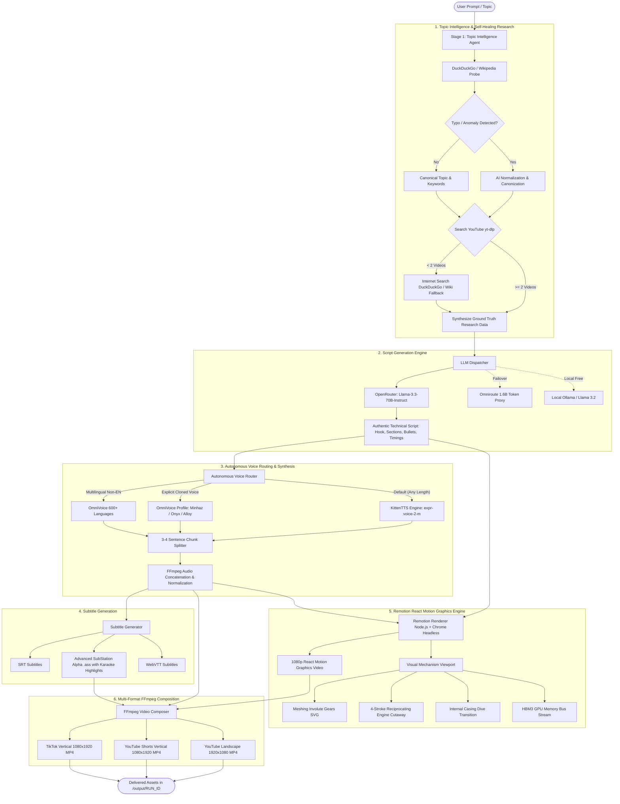

# 🌌 OmniStudio

> **Autonomous End-to-End AI Video Generation, Mechanical Simulation & Technical Content Engine**

[](https://remotion.dev)
[](https://python.org)
[](https://nodejs.org)
[](https://github.com/omniroute/openstudio)
[](https://openrouter.ai)
[](https://ffmpeg.org)
[](LICENSE)

---

## 📖 Table of Contents

- [Overview](#-overview)
- [System Architecture](#-system-architecture)
- [Key Features](#-key-features)
  - [1. Topic Intelligence & Self-Healing Research](#1-topic-intelligence--self-healing-research)
  - [2. Anti-Misconception Script Synthesis](#2-anti-misconception-script-synthesis)
  - [3. Autonomous Voice Routing & KittenTTS](#3-autonomous-voice-routing--kittentts)
  - [4. React/Remotion Visual Mechanisms & Simulation](#4-reactremotion-visual-mechanisms--simulation)
  - [5. FFmpeg Multi-Format Video Composition](#5-ffmpeg-multi-format-video-composition)
- [Visual Mechanical Engine in Action](#-visual-mechanical-engine-in-action)
  - [Motorcycle Constant Mesh Gearbox](#motorcycle-constant-mesh-gearbox)
  - [AI Neural Weights & GPU Silicon Bandwidth](#ai-neural-weights--gpu-silicon-bandwidth)
- [Installation & Setup](#-installation--setup)
- [Usage Guide](#-usage-guide)
  - [Single-Command Execution](#single-command-execution)
  - [CLI Reference](#cli-reference)
  - [Selecting Cloned Voices](#selecting-cloned-voices)
- [Project Structure](#-project-structure)
- [Configuration Reference](#-configuration-reference)
- [Roadmap & Contributing](#-roadmap--contributing)
- [License](#-license)

---

## 🚀 Overview

**OmniStudio** is a fully autonomous, production-grade video content generation engine designed to transform any raw technical or mechanical topic into an authentic, publication-ready video in a single terminal command.

Unlike conventional automation tools that assemble static text bullet slides over stock footage, OmniStudio generates **domain-aware interactive engineering animations, mathematical kinematic cutaways, and hardware simulations**:

* **Got a mechanical topic?** (e.g., *"How a bike's gear box works"*): It renders a 4-stroke engine cutaway with reciprocating piston and spinning counterweighted crankshaft, executes a dynamic camera dive transition inside the engine casing, isolates the constant-mesh transmission cavity, and runs real-time meshing involute gear pairs with sliding dog clutches and shifting torque flow lines.
* **Got an AI/Computing topic?** (e.g., *"How AI model weights determine compute power"*): It visualizes multi-layer neural synaptic networks, dives into floating-point weight matrices (FP16 vs INT4 quantization), and animates GPU high-bandwidth memory (HBM3) streaming bus saturation.

Every video is voiced with natural, ultra-fast **KittenTTS** (or personalized cloned voices like **Minhaz Voice**), synchronized with word-by-word burned-in subtitles, and automatically delivered in **16:9 YouTube** (1080p) and **9:16 Shorts / TikTok** (1080×1920).

---

## 🏛️ System Architecture

The following diagram illustrates how raw user input flows through the 6 autonomous stages of OmniStudio:



---

## ✨ Key Features

### 1. Topic Intelligence & Self-Healing Research
* **Automatic Typo & Error Identification**: Catches transposed, misspelled, or fabricated AI models and engineering terms (e.g., inputting `Spark-X2.6-71.7B` or `Spark-X2.6-7.1.7B` is automatically identified as the real `Spark-X2.6-1.7B` 1.71B-parameter dense model).
* **Live Search-Augmented Grounding**: Probes DuckDuckGo and Wikipedia before making decisions to anchor LLM responses in real-world facts.
* **Cascading Multi-Tier Research**: Queries `yt-dlp` for YouTube community reception; if YouTube results are sparse (<2 videos), cascades seamlessly to live internet documentation and technical specs.

### 2. Anti-Misconception Script Synthesis
* **Zero-Hallucination Prompt Engineering**: Designed specifically to explain real engineering and computer science principles without hand-wavy buzzwords.
* **Exact Mathematical Grounding**: In AI topics, enforces exact formulas:
  $$\text{VRAM Required} = \text{Parameters} \times \text{Bytes per Parameter} + \text{KV Cache}$$
  Distinguishes between compute-bound prefill ($O(N^2)$ FLOPs) and memory-bandwidth-bound decode ($O(N)$ bytes transferred per token).
* **OpenRouter + Omniroute Failover**: Uses **OpenRouter** (`meta-llama/llama-3.3-70b-instruct`) for rapid, high-accuracy script generation, with automatic failover to the local **Omniroute** proxy (1.6 Billion tokens) or local **Ollama**.

### 3. Autonomous Voice Routing & KittenTTS
* **KittenTTS as Universal Default**: Synthesizes clean, high-speed, engaging explainer narration across scripts of any length with zero cold-start delay.
* **Personalized Cloned Voice Support**: Seamlessly switch to custom cloned voices (e.g. `--voice-name Minhaz` or `--voice-id e50a2165`) via local OmniVoice profiles.
* **Chunked Sentence Pipeline**: Long narrations are split into 3–4 sentence chunks, synthesized in sequence, and seamlessly joined with pause normalization to guarantee zero truncation and perfect audio-visual sync.

### 4. React/Remotion Visual Mechanisms & Simulation
* **Not Just Slides**: Replaces boring bullet cards with live React/Remotion mechanical simulations.
* **Kinematic Involute Gears**: Custom SVG gear generators with calculated teeth meshes ($\omega_1 \cdot r_1 = \omega_2 \cdot r_2$).
* **Slider-Crank Slider Simulation**: Trigonometrically accurate piston stroke in single-cylinder engine blocks.
* **Internal Camera Transitions**: Seamless zoom-in penetrating engine crankcases to reveal the constant-mesh transmission cavity.
* **Dual-Column HUD**: 1080p split layout with section telemetry, step badges, and real-time mechanical simulation canvas.

### 5. FFmpeg Multi-Format Video Composition
* Generates synchronized **16:9 Landscape** (YouTube) and **9:16 Vertical** (Shorts, TikTok, Reels) in one run.
* Burns in high-contrast styled subtitles (`.ass`) with karaoke highlights, subtle dark gradient cards, and smooth audio waveforms.

---

## ⚙️ Visual Mechanical Engine in Action

### Motorcycle Constant Mesh Gearbox
When tasked with explaining a motorcycle transmission, OmniStudio generates a specialized 4-stage visual narrative:

```
[ Stage 1: Engine Cutaway ]
   Piston reciprocates in cylinder bore (slider-crank kinematics).
   Spark plug flashes at TDC (combustion cycle).
   Crankshaft counterweights revolve smoothly.
           │
           ▼
[ Stage 2: Casing Penetration ]
   Dynamic camera zoom (1.0x -> 2.3x) dives into lower crankcase.
   Laser scan line highlights the shared oil-bath transmission cavity.
           │
           ▼
[ Stage 3: 6-Speed Constant Mesh Mechanism ]
   Mainshaft (input from clutch) & Countershaft (output to drive sprocket).
   All 6 gear pairs continuously spin in contact.
   Sliding dog clutch collar slides laterally along splines into gear pockets.
   Neon torque flow line visualizes power delivery through engaged ratio.
           │
           ▼
[ Stage 4: Gear Ratios & Shifting Telemetry ]
   1st (2.85:1, +185% torque) -> 2nd (1.88:1) -> 3rd (1.40:1) -> 
   4th (1.14:1) -> 5th (0.96:1) -> 6th (0.81:1 overdrive).
   Interactive dashboard displays Engine RPM vs Wheel RPM.
```

### AI Neural Weights & GPU Silicon Bandwidth
For compute and machine learning topics, OmniStudio renders hardware-accurate diagrams:
* **Synaptic Node Network**: Multi-layer perceptron with pulsing forward-pass activations.
* **Floating-Point Matrix Register**: Dynamic bit-representation comparing FP16 (2 bytes), INT8 (1 byte), and INT4 (0.5 bytes).
* **GPU Memory Bus**: High-bandwidth memory (HBM3) dies transferring data packets at 3,350 GB/s to streaming multiprocessors (SMs) and Tensor Cores.

---

## 📦 Installation & Setup

### Prerequisites
1. **Python**: 3.10 or higher
2. **Node.js**: 18.0 or higher
3. **FFmpeg**: Installed and accessible in PATH (or auto-detected via `imageio-ffmpeg`)
4. **VoiceStudio** (Optional, for local TTS / Voice Cloning): Running at `http://localhost:3900`

### 1. Clone the Repository
```bash
git clone https://github.com/MinhaulMahmud/OmniStudio.git
cd OmniStudio
```

### 2. Python Environment Setup
```bash
cd ContentAutomation
python -m venv venv

# Windows
.\venv\Scripts\activate
# Linux / macOS
source venv/bin/activate

pip install -r requirements.txt
```

### 3. Remotion Graphics Setup
```bash
cd remotion
npm install
cd ..
```

### 4. Configure Environment Variables
Copy `.env.example` to `.env` and insert your API keys:
```bash
cp .env.example .env
```

Edit `ContentAutomation/.env`:
```env
# OpenRouter API Key (Recommended for high-accuracy scripts)
OPENROUTER_API_KEY=your_openrouter_api_key_here
OPENROUTER_MODEL=meta-llama/llama-3.3-70b-instruct

# VoiceStudio Backend (Local KittenTTS & OmniVoice)
VOICESTUDIO_URL=http://localhost:3900
DEFAULT_TTS_MODEL=kittentts
DEFAULT_TTS_VOICE=expr-voice-2-m

# Optional Cloned Voice Override
CLONED_VOICE_NAME=Minhaz
```

---

## 💻 Usage Guide

### Single-Command Execution
Generate an end-to-end video (research, script, voiceover, Remotion motion graphics, multi-format composition) in one command:

```bash
python pipeline.py --topic "how bike gearbox works"
```

Or for AI technology:
```bash
python pipeline.py --topic "AI model weights"
```

### CLI Reference

```text
usage: pipeline.py [-h] [--topic TOPIC] [--topics TOPICS]
                   [--platform {youtube,shorts,tiktok,instagram}]
                   [--formats FORMATS] [--from-script FROM_SCRIPT]
                   [--voice-id VOICE_ID] [--voice-name VOICE_NAME]
                   [--language LANGUAGE] [--list-voices]
                   [--no-research] [--no-video] [--remotion]
                   [--no-remotion] [--output-dir OUTPUT_DIR]

Options:
  --topic TOPIC          Single topic to generate content for
  --topics TOPICS        Comma-separated list of topics
  --platform PLATFORM    Target format (default: youtube)
  --formats FORMATS      Output video formats: youtube,shorts,tiktok (default: all)
  --voice-name NAME      Voice name to use (e.g. Minhaz, alloy, expr-voice-2-m)
  --voice-id ID          Voice ID to use
  --language LANG        Audio language (e.g. en, es, bn, hi, auto)
  --list-voices          List all available voices in VoiceStudio and exit
  --no-research          Skip yt-dlp & web research step
  --no-video             Only generate script and audio, skip video rendering
  --remotion             Render React Remotion motion graphics (default: True)
  --no-remotion          Disable Remotion motion graphics; use FFmpeg gradients
```

### Selecting Cloned Voices
By default, OmniStudio uses **KittenTTS** (`expr-voice-2-m`) for all audio lengths for lightning-fast, studio-quality explainer audio. 

To use your own cloned voice profile from VoiceStudio:
```bash
# List all connected cloned voices
python pipeline.py --list-voices

# Run with cloned voice
python pipeline.py --topic "AI model weights" --voice-name Minhaz
```

---

## 📁 Project Structure

```text
OmniStudio/
├── README.md                          # Project Documentation & Architecture
├── .gitignore                         # Git exclusion rules
├── ContentAutomation/                 # Core Python Pipeline & Engines
│   ├── .env.example                   # Environment variable template
│   ├── config.py                      # Central configuration & paths
│   ├── pipeline.py                    # Master End-to-End Orchestrator
│   ├── topic_intelligence.py          # AI Typo Correction & Grounding Agent
│   ├── researcher.py                  # yt-dlp & DuckDuckGo/Wikipedia Research
│   ├── script_generator.py            # OpenRouter / Omniroute Technical Scriptwriter
│   ├── autonomous_voice_router.py     # Language & Duration Voice Routing Engine
│   ├── voice_client.py                # VoiceStudio & KittenTTS HTTP Client
│   ├── subtitle_generator.py          # Word-level SRT, ASS, and WebVTT generator
│   ├── remotion_renderer.py           # Automated Node.js Remotion CLI Invoker
│   ├── video_composer.py              # FFmpeg Multi-Format Video Composer
│   ├── remotion/                      # React Motion Graphics Codebase
│   │   ├── package.json               # Remotion dependencies
│   │   ├── src/
│   │   │   ├── index.ts               # Remotion entry point
│   │   │   ├── Root.tsx               # Composition registry
│   │   │   ├── DynamicExplainer.tsx   # Universal split-screen HUD explainer
│   │   │   ├── BikeGearboxComposition.tsx # 6-Speed Motorcycle Transmission
│   │   │   ├── ModelWeightsComposition.tsx # AI Model Weights & Bandwidth
│   │   │   ├── components/
│   │   │   │   ├── GearWheel.tsx                  # Involute gear generator
│   │   │   │   ├── EngineCrossSection.tsx         # 4-stroke engine cutaway
│   │   │   │   ├── SequentialGearboxMechanism.tsx # 6-speed gear simulator
│   │   │   │   └── VisualMechanismViewport.tsx    # Dynamic topic visualizer
│   │   │   └── scenes/
│   │   │       ├── gearbox/           # Dedicated mechanical scenes
│   │   │       └── *.tsx              # Hardware & compute scenes
│   └── output/                        # Delivered videos, scripts, audio & subtitles
```

---

## 🔧 Configuration Reference

All settings can be customized in `ContentAutomation/config.py` or overridden via environment variables in `.env`:

| Variable | Default Value | Description |
| :--- | :--- | :--- |
| `OPENROUTER_API_KEY` | `""` | OpenRouter API Key for technical script generation |
| `OPENROUTER_MODEL` | `meta-llama/llama-3.3-70b-instruct` | Preferred LLM model for technical accuracy |
| `VOICESTUDIO_URL` | `http://localhost:3900` | Local VoiceStudio backend endpoint |
| `DEFAULT_TTS_MODEL` | `kittentts` | Default TTS engine (`kittentts` or `omnivoice`) |
| `DEFAULT_TTS_VOICE` | `expr-voice-2-m` | Default voice preset |
| `LLM_BACKEND` | `openrouter` | Active LLM (`openrouter`, `omniroute`, `ollama`) |
| `VIDEO_WIDTH` | `1920` | Output landscape video width |
| `VIDEO_HEIGHT` | `1080` | Output landscape video height |
| `VIDEO_FPS` | `30` | Render framerate |
| `OUTPUT_FORMATS` | `youtube,shorts,tiktok` | Delivery video aspect ratios to generate |

---

## 🗺️ Roadmap

- [x] Autonomous Topic Intelligence & Typo Auto-Correction
- [x] OpenRouter Llama 3.3 70B Technical Scriptwriting
- [x] KittenTTS Default Voiceover Integration
- [x] Chunked Voice Synthesis with Zero Pause Bleeding
- [x] React / Remotion Involute Gear & Engine Kinematics Engine
- [x] Multi-format (16:9 Landscape & 9:16 Vertical) Video Delivery
- [ ] 3D WebGL / Three.js Visual Viewports in Remotion
- [ ] Direct Social Media Publishing API (YouTube Data API v3 & TikTok API)
- [ ] Autonomous Thumbnail Generator with Visual Mechanism Highlights

---

## 📄 License

This project is licensed under the MIT License - see the [LICENSE](LICENSE) file for details.

---

<p align="center">
  <b>Built with ❤️ by Minhazul Mahmud</b><br>
  <i>Empowering creators with autonomous, mechanically authentic visual storytelling.</i>
</p>
